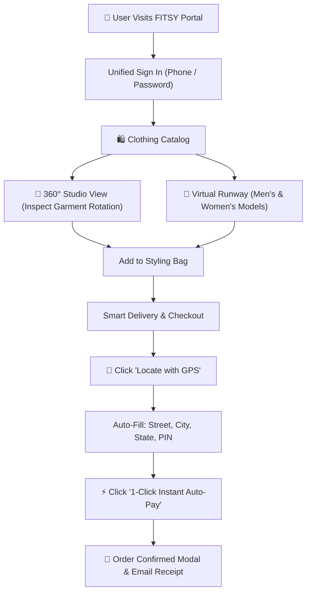
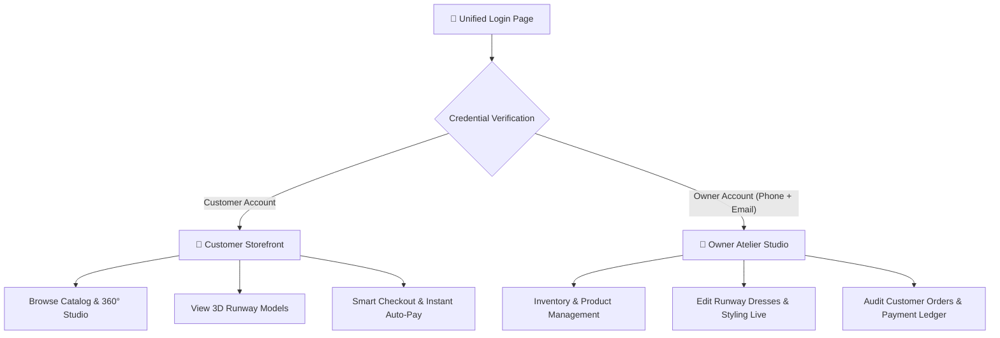

# 👗 FITSY — Digital Fashion & 3D Runway Clothing Portal
<p align="center">
  <b>Simplifying Fashion Shopping, Enhancing Digital Apparel Experience.</b>
  <br>
  An interactive e-commerce platform combining 360° garment visualization, virtual runway styling, and intelligent store management.
</p>
---
## 📌 1. Project Overview
The **FITSY Digital Fashion Portal** is a web-based e-commerce application designed to revolutionize online apparel shopping. 
Unlike traditional platforms with flat images, FITSY enables customers to explore garments in **interactive 360° rotational 3D**, preview complete outfits on **virtual runway models**, and complete orders with **accurate GPS location pinning** and **1-click automated payment**.
Store owners get a dedicated **Owner Studio** to curate products, live-edit runway dresses on demo models, and track customer orders in real time.
---
## 🎯 2. Key Objectives
- Provide realistic **360° and 3D clothing visualization**.
- Present coordinated outfits on **interactive virtual models** (with strict Men/Women department isolation).
- Deliver an intuitive and responsive shopping experience from browsing to checkout.
- Provide a dedicated **Owner Atelier Studio** to edit worn dresses, manage catalog, and monitor orders.
- Enable **pinpoint GPS location detection** (road, city, state) and **1-click automated payment**.
---
## 🚀 3. Key Features
| Feature | Description |
|---|---|
| 🛍️ **Curated Catalog** | Browse clothing collections with category filters, search, and gender isolation. |
| 🔄 **360° Studio View** | Rotate and inspect garments interactively with authentic front and back views. |
| 👗 **Virtual Runway** | Preview coordinated looks on tailored Men's and couture Women's demo models. |
| ✨ **Owner Atelier Studio** | Edit dresses and styling worn by runway models, add bespoke pieces, and publish live. |
| 📍 **Smart GPS Checkout** | Automatically detect road name, city, state (Telangana), and PIN with GPS reverse geocoding. |
| ⚡ **1-Click Auto-Pay** | Instant automated bank verification and email invoice dispatch without manual UTR typing. |
| 📦 **Order Management** | Real-time order tracking, payment verification, and dispatch ledger for the store owner. |
| 📱 **Responsive Design** | Fluid layouts optimized for both mobile devices and desktop screens. |
---
## 🏗️ 4. System Workflows & Flowcharts
### A. End-to-End Shopping & Checkout Workflow

---
### B. High-Level Platform Architecture

```mermaid
flowchart LR
    subgraph Frontend["🖥️ Client Application"]
        UI["Modern Web Interface"]
        ThreeJS["Three.js / WebGL (3D Rotation)"]
        Runway["Virtual Runway Engine"]
    end
    subgraph Backend["⚡ Node.js Server"]
        API["REST APIs & Routing"]
        Geo["GPS Reverse Geocoding Proxy"]
        Pay["Automated Payment Engine"]
    end
    subgraph Database["💾 SQLite Database"]
        DB[("brand_auth.db")]
        Tables["Products • Orders • Users • Runway Demos"]
    end
    Frontend <-->|"REST API Requests"| Backend
    Backend <-->|"SQL Queries & Transactions"| Database
    Database --- Tables
```

---
### C. Role-Based Dual Flow (Customer vs. Owner)

---
## 🛠️ 5. Technology Stack
| Layer | Technologies Used |
|---|---|
| **Frontend UI** | HTML5, CSS3, JavaScript (ES6+), TypeScript |
| **3D Visualization** | Three.js, WebGL |
| **Build & Bundling** | Vite |
| **Backend Server** | Node.js (REST API) |
| **Database** | SQLite (WAL Production Mode) |
| **Location Services** | OpenStreetMap Nominatim, Leaflet.js |
| **Version Control** | Git & GitHub |
---
## ⚙️ 6. Quick Setup & Run Guide
```bash
# 1. Install root dependencies
npm install
# 2. Build the studio bundle
cd studio
npm install
npm run build
cd ..
# 3. Synchronize static build
node scripts/extracted_rebuild_script.js
# 4. Start the server
node server.js
```
Application will be live at: **`http://localhost:5000/`**
---
## 🔑 7. Login Credentials
| Account | Phone Number | Password | Email | Access |
|---|---|---|---|---|
| **👑 Store Owner** | `9876543210` | `9876543210` | `manideepstar92@gmail.com` | Owner Atelier Dashboard |
| **👤 Customer** | `9000000000` | `customer123` | — | Customer Storefront |
---
## 👥 8. Team Members
| Student ID | Name |
|---|---|
| **2620030089** | **Manideep** |
| **2620030104** | **Gowtham Sai** |
| **2620030105** | **Vishwak** |
---
<p align="center">
  👗 <b>FITSY — Dress Better. Live Bolder.</b>
  <br>
  Developed with ❤️ using modern web technologies.
</p>
