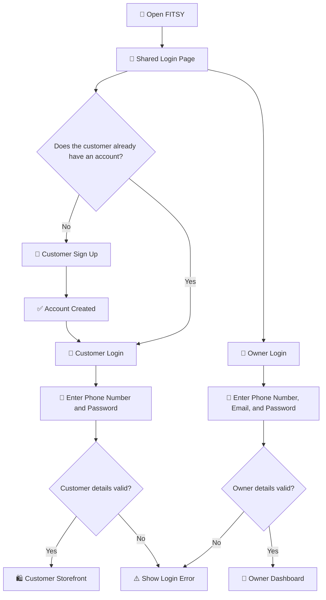
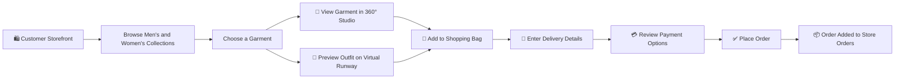
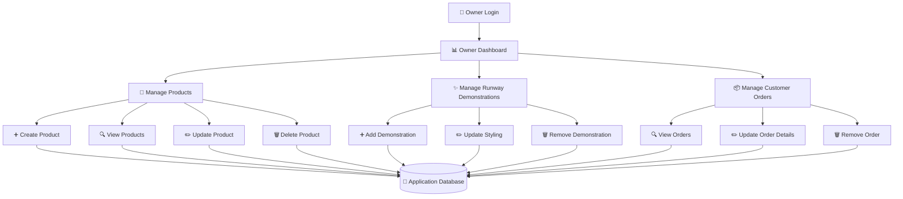
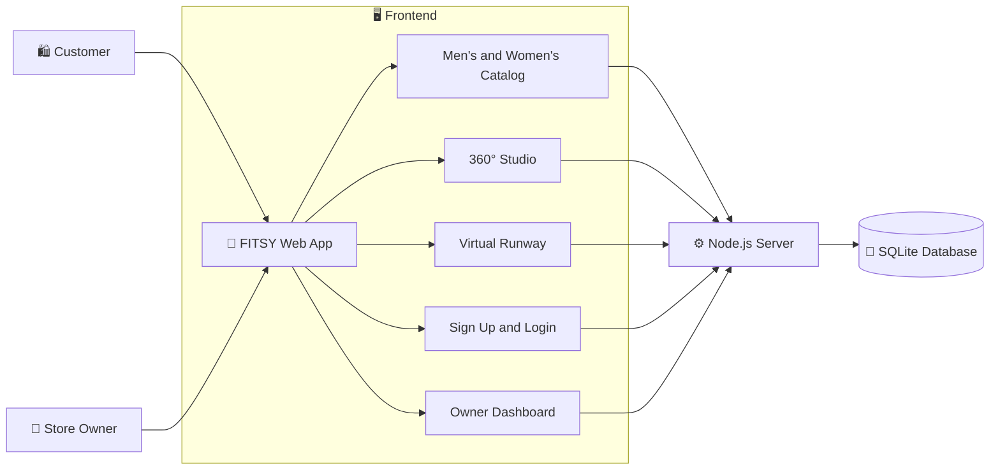

# 👗 FITSY 👔

### ✨ Digital Fashion & 3D Runway Clothing Portal ✨

**Discover your style. Explore every detail. Shop with FITSY.**

A digital fashion app for exploring **Men’s and Women’s collections**, viewing garments in 360°, and styling outfits on a virtual runway.

---

## 📖 About FITSY

**FITSY** is a digital fashion shopping app designed to make clothing discovery more interactive. Customers can explore **Men’s and Women’s collections**, view garments from different angles using 360° visualization, and preview outfits on virtual runway models.

FITSY also provides store owners with a dashboard to manage products, runway demonstrations, and customer orders.

---

## ✨ Features

| Feature | Description |
|---|---|
| 🛍️ **Fashion Catalog** | Browse Men’s and Women’s collections with search and category filters. |
| 🔄 **360° Studio View** | Rotate garments and inspect their designs from different angles. |
| 👗 **Virtual Runway** | Preview styled outfits on virtual models. |
| 🔐 **Account Access** | New customers can sign up; existing customers and owners can log in. |
| 📍 **Checkout** | Enter delivery details and review order information. |
| 📦 **Order Management** | Owners can review and manage customer orders. |
| 🎨 **Owner Dashboard** | Owners can manage products and runway demonstrations. |
| 📱 **Responsive Design** | Browse FITSY on desktop and mobile screens. |

---

## 🔐 Customer and Owner Access

FITSY uses **one shared login page**. After the account details are checked, the user is directed to the appropriate area.

- **New customer:** Sign up first, then log in.
- **Existing customer:** Log in with a phone number and password.
- **Owner:** Log in with a phone number, email address, and password.

---

## 🛍️ Customer Shopping Journey

Customers can browse Men’s and Women’s clothing, explore garments, and place orders.

---

## 👑 Owner Dashboard

The owner dashboard provides product, runway, and order management tools. Depending on the application’s implementation, these actions can create, view, update, or delete records in the database.

---

## 🏗️ FITSY System Architecture

---

## 🧰 Technology Stack

| Area | Technologies |
|---|---|
| **Frontend** | HTML5, CSS3, JavaScript, TypeScript |
| **3D Visualization** | Three.js, WebGL |
| **Build Tool** | Vite |
| **Backend** | Node.js |
| **Database** | SQLite |
| **Maps and Location** | Leaflet.js, OpenStreetMap Nominatim |
| **Version Control** | Git, GitHub |

---

## 🌟 Why FITSY?

- 👔 Explore clothing from **Men’s and Women’s collections**.
- 🔄 Inspect garments with interactive 360° views.
- ✨ Preview outfits on a virtual runway.
- 🔐 Use a shared sign-in page with separate customer and owner access.
- 📦 Give owners tools to manage products, runway demonstrations, and orders.
- 📱 Browse using a responsive interface.

---

## 👥 FITSY Team

### ✨ Meet the Team ✨

| 🪪 Student ID | 👤 Team Member |
|:---:|:---|
| `2620030089` | **Manideep** |
| `2620030105` | **Gowtham Sai** |
| `2620030104` | **Vishwak** |

**Together, building a more interactive fashion experience.** 👗👔

---

# 👗 FITSY 👔

### **Fashion for Men. Fashion for Women. Style for Everyone.**

*Discover your look. Make it FITSY.* ✨

