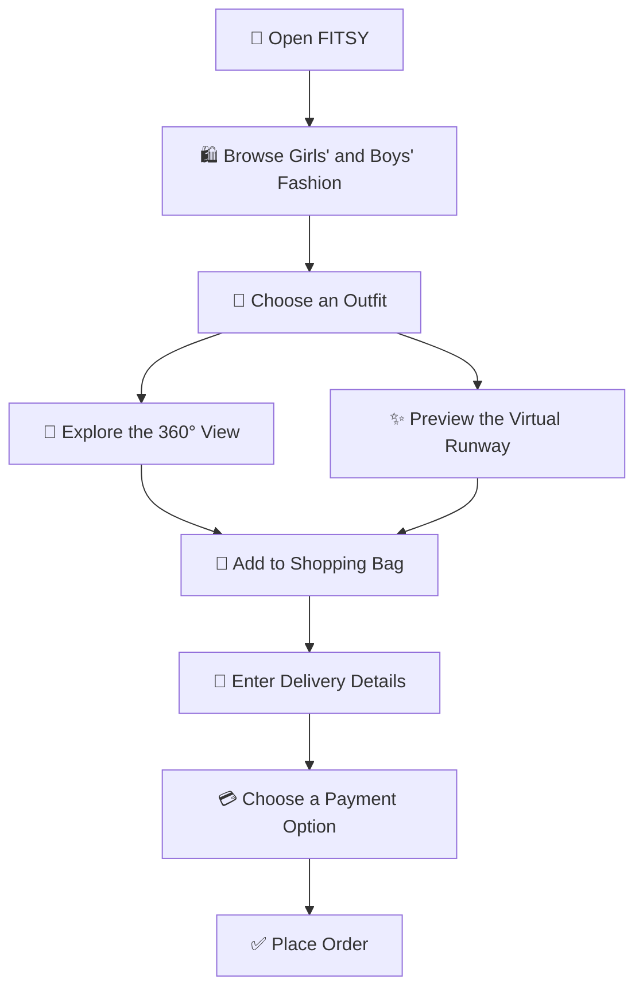
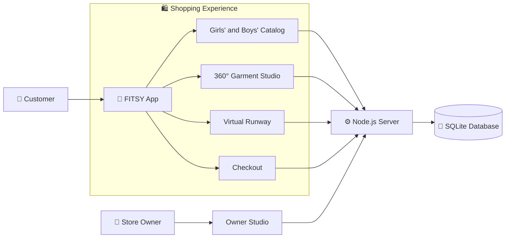
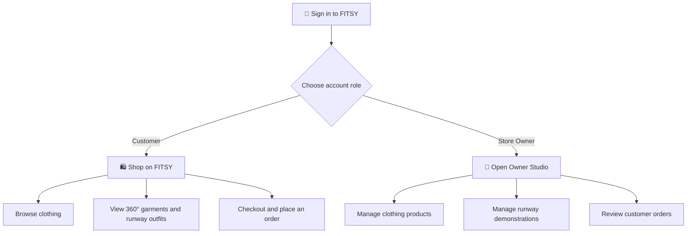

<div align="center">

# 👗 FITSY 👔

### 👧🏻 Girls’ Fashion · 👦🏻 Boys’ Fashion · ✨ Your Style

**Discover outfits. Explore every angle. Find your FITSY style.**

A digital fashion shopping app featuring clothing collections, 360° garment views, virtual runway styling, and store management.


</div>

---

## 📖 About FITSY

**FITSY** is a digital fashion shopping app for discovering clothing and creating new looks. Browse collections for girls and boys, explore garments with interactive 360° views, and preview outfits on virtual runway models.

FITSY also includes an owner studio for managing clothing products, runway demonstrations, and customer orders.

---

## ✨ What You Can Do

- 👗 **Explore girls’ fashion** and discover outfit ideas.
- 👔 **Browse boys’ clothing** and find styles for every look.
- 🛍️ **Shop clothing collections** with search and category filters.
- 🔄 **View garments in 360°** to inspect their design from different angles.
- 🧍 **Preview runway outfits** on virtual models.
- 🛒 **Continue to checkout** with delivery and payment options.
- 🎨 **Manage the store** through the owner studio.
- 📦 **Review customer orders** in the owner dashboard.
- 📱 **Browse on mobile or desktop** with a responsive interface.

---

## 🛒 Shopping Flow



---

## 🏗️ How FITSY Works



---

## 👥 Customer and Owner



---

## 🧰 Technology

| Part of the App | Technologies |
|---|---|
| **Web Interface** | HTML5, CSS3, JavaScript |
| **3D Fashion Views** | Three.js, WebGL |
| **Build Tool** | Vite |
| **Server** | Node.js |
| **Database** | SQLite |
| **Maps and Location** | Leaflet.js, OpenStreetMap Nominatim |
| **Version Control** | Git, GitHub |

---

## ⚙️ Run FITSY Locally

You’ll need **Node.js** and **npm** installed.

```bash
# Install the main project dependencies
npm install

# Build the studio
cd studio
npm install
npm run build
cd ..

# Synchronize the built files
node scripts/extracted_rebuild_script.js

# Start the server
node server.js
```

Then open **http://localhost:5000/** in your browser.

---

## 👥 FITSY Team

<div align="center">

| Student ID | Team Member |
|:---:|:---|
| 2620030089 | Manideep |
| 2620030105 | Gowtham Sai |
| 2620030104 | Vishwak |

</div>

---

<div align="center">

# 👗 FITSY 👔

### 👧🏻 Fashion for her · 👦🏻 Fashion for him · ✨ Style for everyone

**Find your look. Make it FITSY.**

</div>
